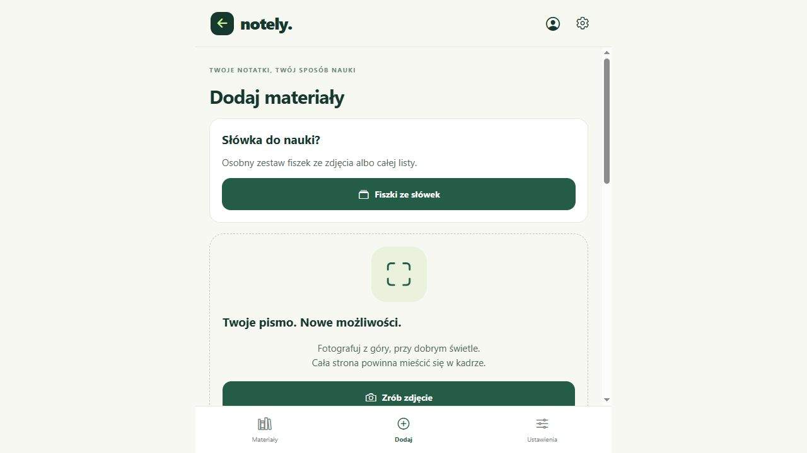

# Import dokumentów i plików — 12 października 2026

## Zakres i wynik

- `node --test audits/document-import.test.mjs`: **10/10 PASS**. Osobny zestaw, poza domyślnym `npm test`.
- Przeglądarka przez rzeczywisty interfejs Notely localhost:8081: import 6 PNG + PDF + WAV, kolejność, podpisy, przeładowanie, pusty plik, plik z błędnym typem.
- **Rzeczywisty OCR/model chmurowy NOT TESTED:** brak skonfigurowanego klucza w bieżącym środowisku. Żadnego klucza użytkownika nie odczytywano. Nie testowano fizycznego telefonu, mikrofonu ani słyszalności głośnika.
- Własne fixtures z `audits/create-import-fixtures.mjs` w `audits/fixtures/import/`: osiem kolorowych PNG 64×64 (nie notatki do OCR), PDF z własnym zdaniem „Own test: potato is a stem tuber.”, sekundowy ton WAV, pusty PNG i tekst podszywający się pod PDF.

## Scenariusze przeglądarkowe

| Test | Obserwacja |
| --- | --- |
| Wybór ośmiu mieszanych plików | Widoczne 8/8, kolejno sześć PNG, PDF i WAV; przycisk nagrywania poprawnie disabled przy limicie. |
| Kolejność i podpis | PDF przesunięty z miejsca 7 na 6, podpis „Własny PDF testowy”, tytuł „TEST IMPORT 2026-10-12”. |
| Restart podglądu | Po reload i ponownym wejściu w Dodaj wszystkie osiem plików, kolejność, podpis oraz tytuł przetrwały. Sześć obrazów miało `complete=true`, `naturalWidth=64`. |
| Audio metadata | Po importowaniu i reload WAV miał widoczny czas 0:01. To dowód załadowania metadanych, nie odsłuchu. |
| OCR bez konfiguracji | Lokalny tryb z audio zwraca czytelny błąd wymagający OpenAI/Gemini; pliki pozostają. |
| Rollback importu | Wybór prawidłowego PNG + pustego PNG daje stały komunikat „Plik jest pusty”, licznik 0/8. Nie pozostawia pierwszego pliku w szkicu. |
| Błędna sygnatura PDF | `mismatch.pdf` (zwykły tekst) zostaje przyjęty przez UI. Walidator serwera odrzuca go przed wywołaniem modelu. Patrz uwaga poniżej. |
| Sprzątanie | Usunięto wyłącznie własne załączniki szkicu i testowy tytuł. Lista istniejących materiałów nadal zawiera 5 pozycji. Nie tworzono lekcji testowej, nie kasowano cudzych materiałów ani wcześniejszych testów. Podgląd zostawiono na liście materiałów. |

Dowód pustego szkicu po sprzątaniu:

## Kontrolowane testy IO i pipeline

1. Bity PNG/PDF/WAV odtworzone po świeżym załadowaniu modułu źródeł i odbudowie URL; fake IndexedDB współdzielony między instancjami.
2. Pusty plik, HTTP failure i przekroczenie limitu 8 MB nie zapisują źródła.
3. Usuwanie własnego źródła usuwa blob i URL.
4. Osiem mieszanych załączników zachowuje **1600 wierszy** i ostatni wiersz `7:199`; odczyt odbywa się kolejno bez zmiany kolejności i bez utraty offsetów niepewności.
5. Błąd dostawcy na trzecim pliku nie zwraca pozornie kompletnej lekcji; dalsze pliki nie są wysyłane.
6. Duże litery rozszerzenia PDF/M4A akceptowane; DOCX nieobsługiwany i poprawnie nierozpoznawany jako wspierany.
7. Sygnatura sprzeczna z MIME i pusty payload odrzucone przez serwer.
8. Kopia natywna sprawdzana po zakończeniu operacji, niepełna kopia odrzucana.

To testy rzeczywistego kodu z podstawionym IO/modelami, nie dowód jakości rozpoznawania pisma ani merytoryki nowych opracowań.

## Odtworzone problemy zgłoszone koordynatorowi

### P2: błąd odczytu źródła w przeglądarce może zostać wysłany jako plik

Stan przed naprawą: `src/api.ts`, `transcribe` → `encode` używał `fetch(source.uri).blob()` bez sprawdzenia `response.ok` lub rozmiaru. `node audits/source-http-repro.mjs` zwróciło `{"uploadsDespiteSource404":1}`: kontrolowany 404 HTML zamieniał się w payload `/api/transcribe`. Serwer chronił model walidacją sygnatury, ale użytkownik dostawał mylący błąd typu/OCR zamiast informacji o niedostępnym oryginale.

**Naprawione przez koordynatora i niezależnie sprawdzone:** helper `src/sourceRead.ts` przed FileReader sprawdza HTTP, typ strony błędu, pusty blob i rozmiar. Reproduktor zaimportował prawdziwe nowe helpery (nie podstawione funkcje): komunikat „Nie udało się odczytać zapisanego pliku (HTTP 404). Dodaj ten plik ponownie.” i `{"uploadsDespiteSource404":0}`. Osobne 10 testów importu nadal PASS. Tester nie edytował produkcji.

### P3: ograniczenie nazwy pliku nie jest spójne między importem i serwerem

Stan przed naprawą: import nie blokował długości nazwy; `validateFiles` odrzucał nazwy powyżej 180 znaków ogólnym „Obsługujemy pliki…”. Koordynator dodał `uploadFilename` skracający samą nazwę transportową do 180 znaków z zachowaniem rozszerzenia. Oryginalna nazwa w UI pozostaje. Szczegółowe regresje helpera wykonuje koordynator.

### P3: błędny typ wykrywany dopiero podczas OCR

UI importuje `mismatch.pdf` jako PDF, bo rozpoznaje rozszerzenie i MIME. Serwer prawidłowo blokuje payload. To bezpieczne odrzucenie, ale komunikat podczas wyboru pliku byłby bardziej pomocny. Nie oznacza to, że model faktycznie przeczytał taki plik.

## Następne próby potrzebne do jakości OCR

Rzeczywiste zdjęcie ręcznej notatki, PDF z tekstem i skanowany PDF, audio mowy → realny Gemini/OpenAI → porównanie odczytu ze źródłem → kontrola notatek i mapy przez drugiego testera. W tej rundzie brak klucza uniemożliwił ten etap; nie zastępujemy go symulowanym „PASS”.

## Dodatkowa próba nowego widoku notatki i mapy na 320 px

**NOT TESTED w przeglądarce przez tego testera.** Po zakończeniu zmian adaptive_notes koordynator zlecił otworzenie istniejącego przykładu demonstracyjnego przy 320 px, rozwijanie gałęzi i sprawdzenie źródeł. Po wznowieniu narzędzie CUA zwróciło `apps: [], browsers: []`; poprzedni browser2 był niedostępny. Zgłoszono ten konkretny blocker koordynatorowi. Wcześniejszy test importu przez UI wykonano przed utratą powierzchni przeglądarki. Nie utożsamiamy przejścia testów automatycznych z weryfikacją nowej prezentacji mobilnej.
